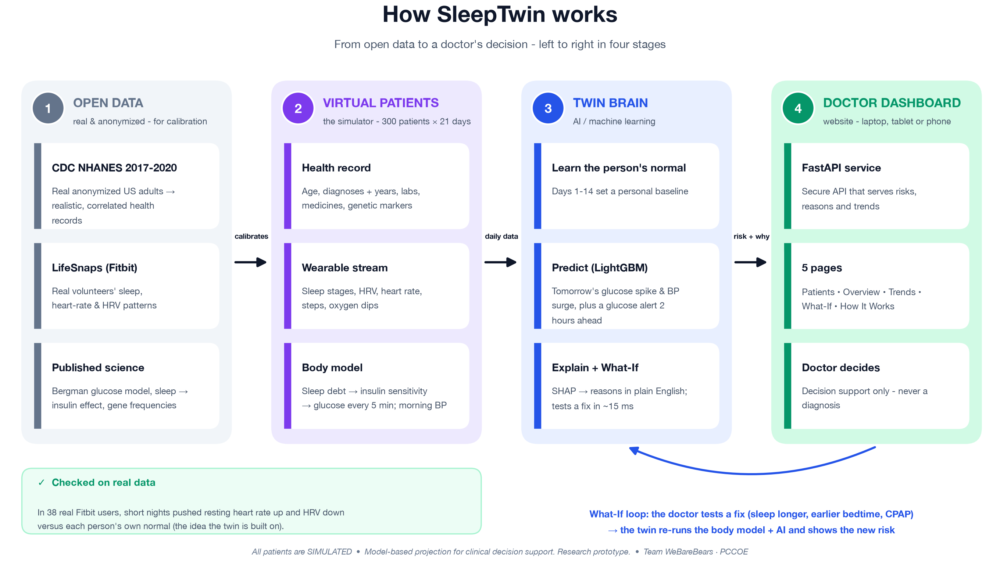

# SleepTwin — a sleep-driven cardiometabolic digital twin (T2D + Hypertension)

**Team WeBareBears** · **PCCOE**

> 🎥 **Demo video (≥ 20 min):** `[PASTE UNLISTED YOUTUBE LINK HERE]`
> 📐 **Architecture:** [`docs/architecture.pdf`](docs/architecture.pdf) · 📊 **Presentation (14 slides, project details + outcomes):** [`docs/SleepTwin_Presentation.pdf`](docs/SleepTwin_Presentation.pdf) / [`docs/SleepTwin_Presentation.pptx`](docs/SleepTwin_Presentation.pptx) · 📈 **Results:** [`reports/results.md`](reports/results.md)
> 📘 **Guide:** [Project overview](docs/PROJECT_OVERVIEW.md)

> ⚠️ **Model-based projection for clinical decision support. Research prototype.** Not a diagnostic tool. **All patient data is simulated.**

---

## Submission checklist (Happiest Health Digital Twin Challenge 2026)

| Required | Where |
|---|---|
| Team details + college / incubator | [Team](#team) — **WeBareBears**, **PCCOE** |
| Project title | **SleepTwin** — a sleep-driven cardiometabolic digital twin |
| Problem statement + healthcare use case | [Problem statement & healthcare use case](#problem-statement--healthcare-use-case) |
| Technical stack + AI/ML model / framework | [Technical stack](#technical-stack) · [AI/ML model details](#aiml-model-details) |
| Video (≥ 20 min, unlisted YouTube or PowerPoint recording) | Link at the top of this README |
| Open-source licence | [MIT](LICENSE) — see [Licence](#licence) (dataset licences listed) |
| Architecture diagram (PDF/PPT) | [`docs/architecture.pdf`](docs/architecture.pdf) (also slide 5 of the deck) |
| Presentation (PDF/PPT) with project details + outcome | [`docs/SleepTwin_Presentation.pdf`](docs/SleepTwin_Presentation.pdf) · [`docs/SleepTwin_Presentation.pptx`](docs/SleepTwin_Presentation.pptx) |

## Team

| | |
|---|---|
| Team name | **WeBareBears** |
| College / incubator | **PCCOE** |
| Members (all full-time students) | `[P1 – Data & Model]`, `[P2 – Simulator, Backend & Integration]`, `[P3 – Frontend, Design & Video]` |
| Challenge | Happiest Health Digital Twin Challenge 2026 — Phase 1 (Prototype & Code Submission) |

> Root folder follows the required `Team Name_College Name` format: `WeBareBears_PCCOE`.

## Architecture



PDF version: [`docs/architecture.pdf`](docs/architecture.pdf). The four stages, left to right: **open data** (used only for calibration) → **virtual patients** (the simulator) → **twin brain** (personal baseline, LightGBM forecasts, SHAP explanations, What-If) → **doctor dashboard**. The doctor's What-If changes feed back into the twin.

## Problem statement & healthcare use case

A person with type 2 diabetes or high blood pressure sees a doctor for about 15 minutes every few months, and nothing in between is visible. Yet **a few nights of bad sleep can quietly push a diabetic's blood sugar too high the next day, or raise blood pressure the next morning.** Smartwatches record sleep every night, but they give a generic score. They don't know the wearer is a 54-year-old diabetic on a beta-blocker.

**SleepTwin** is a virtual copy of each patient. It fuses the (simulated) **health record** with the (simulated, open-data-shaped) **wearable stream** and does the following:

1. learns each person's own normal (days 1–14),
2. spots nightly drift (short sleep, late bedtime, HRV drop, oxygen dips),
3. predicts **tomorrow's glucose spike (> 180 mg/dL)** and **morning BP surge (SBP > 145)**,
4. gives a **2-hour-ahead glucose spike alert** from the live CGM,
5. **explains** every alert in plain English (SHAP), and
6. lets the doctor test fixes with **What-If** sliders (sleep hours, bedtime, CPAP) before applying them.

*A smartwatch tells you that you slept badly. SleepTwin tells your doctor what that bad sleep will do to your body tomorrow, and what to change tonight to prevent it.*

**Condition:** type 2 diabetes with hypertension, both highly prevalent in India.

## Quick start — Windows, macOS or Linux (< 10 min)

Requirements: **Python 3.11 – 3.14** (developed on 3.14, also tested on 3.11). The open datasets are **included in the repo**, so no data download is needed — internet is only used for `pip install`. **Node.js 20.19+ / 22.12+** is only needed if you want to rebuild the website (a pre-built copy in `web/dist` is used otherwise).

**macOS**
```bash
brew install libomp          # required by LightGBM on macOS
python3 -m venv .venv
source .venv/bin/activate
pip install -r requirements.txt
python run.py
```

**Linux**
```bash
python3 -m venv .venv
source .venv/bin/activate
pip install -r requirements.txt
python run.py
```

**Windows (PowerShell or Command Prompt)**
```bat
py -m venv .venv
.venv\Scripts\activate
pip install -r requirements.txt
python run.py
```

`run.py` does whatever is missing (simulate 300 patients → train models, about 30 s on first run; the datasets and the built website are already included) and then serves everything on **http://127.0.0.1:8000**. API docs: **http://127.0.0.1:8000/docs**.

| Option | What it does |
|---|---|
| `python run.py --lan` | Also open it from **phones / tablets** on the same Wi-Fi (prints the address, e.g. `http://192.168.1.81:8000`) |
| `python run.py --port 9000` | Use another port |
| `python run.py --open` | Open the browser automatically |
| `python run.py --rebuild` | Re-run the data pipeline and rebuild the website |
| `python run.py --skip-setup` | Just start the server |

Manual steps (same result): `python -m src.pipeline` → `pytest -q` → `uvicorn api.main:app --port 8000`. Only if you change the website: `cd web && npm ci && npm run build`. Only to re-fetch the datasets from the official sources: delete `data/raw/` and run `python scripts/download_data.py`.

**Developer mode** (hot reload): `uvicorn api.main:app --port 8000 --reload` in one terminal and `cd web && npm run dev` in another, then open http://localhost:5173 (Vite proxies `/api` to :8000). The frontend can also run against the frozen mock contracts: `VITE_USE_MOCKS=1 npm run dev`.

**Regenerate docs** (with the app running on :8000): `python scripts/take_screenshots.py && python scripts/make_docs.py` (finds Chrome, Edge or Chromium on any OS).

### Demo walkthrough (the three personas — header buttons A / B / C)

| Persona | Story | What you see |
|---|---|---|
| **A** — Rajesh, 54 M, T2D (HbA1c 8.1), HTN, metformin + metoprolol, high PRS | 4 nights of ~5 h, bedtime +2 h, HRV −32%, resting HR only +3 (beta-blocker masking) | **Critical** next-day risk + **2-hour alert after lunch**. What-If → 7.5 h at usual bedtime → **Stable**, tomorrow's curve flattens |
| **B** — Sunita, 41 F, prediabetes, BMI 32, **undiagnosed sleep apnea** | Sleeps 7.2 h (looks fine) but ~79 min awake and ~22 oxygen dips/h | **Warning** (morning BP) + "possible hidden sleep apnea" flag. What-If → CPAP → **Stable** |
| **C** — Arjun, 27 M, healthy runner, low genetic risk | One bad 4.5 h night | **Stable** with no alarm; the night is shown as "noted, not enough to raise risk" |

Shareable What-If presets: `/patients/A/what-if?sleep=7.5&shift=0`, `/patients/B/what-if?cpap=1`.

## The product (6 pages)

| Page | Route | Contents |
|---|---|---|
| About | `/about` | Overview of the two data streams, simulator model, equations, ablation results, 2-hour alert validation, LifeSnaps evidence, data card, limitations, sources and disclaimer |
| Patients | `/` | Search + filters, table sorted by risk, red/amber/green risk badge, 2-hour alert icon and one-line top reason |
| Overview | `/patients/:id` | EHR summary (demographics, diagnoses, labs, meds, **genetic markers labelled simulated**), next-day glucose and BP gauges, 2-hour alert banner, SHAP-based "Why" panel, beta-blocker masking and hidden-apnea flags, data-quality chip, **Open What-If** |
| Trends | `/patients/:id/trends` | Time-series views for CGM, sleep, hypnogram, HRV/resting HR and O₂ dips; each chart includes a green **personal-normal band** |
| What-If | `/patients/:id/what-if` | Sleep-hours slider, bedtime-shift slider, CPAP toggle, nights covered, reset control, before/after risk gauges, and before/after glucose curve with updated reasons |
| Abbreviations | `/abbreviations` | Glossary of medical and model abbreviations used across the app, including HbA1c, HRV, RHR, SBP, ODI, TST, WASO and others |

Every risk screen shows the disclaimer, and the header always shows a **"Simulated data"** badge.

## Technical stack

| Layer | Tools |
|---|---|
| Data / ML / API | Python 3.11–3.14 · pandas 3 · numpy 2 · pyarrow (Parquet, no database) · scipy |
| Physiology | Bergman minimal model, fixed-step (1 min) Euler, vectorised across patients |
| ML | LightGBM 4.7 (monotone constraints) · scikit-learn 1.9 `GroupKFold` · SHAP 0.51 `TreeExplainer` · joblib |
| API | FastAPI 0.146 · uvicorn 0.54 · pydantic 2.14 (typed contracts, `/docs`) |
| Frontend | React 19.3 + TypeScript 6.0 + Vite 8 · React Router 7 · Tailwind CSS 4 · Recharts 3 · self-hosted Inter font |
| Tests | pytest — 37 tests (simulator, leakage, API contract, personas, What-If, security) |
| Docs | matplotlib (architecture), python-pptx + reportlab (slides), headless Chrome/Edge (screenshots) |

All dependencies are on their latest releases (October 2026). One deliberate exception: TypeScript is 6.0.3 rather than 7.0, because the linter (`typescript-eslint`) does not support TypeScript 7 yet. `pip-audit` and `npm audit` both report **0 known vulnerabilities**.

## Compatibility & security

**Runs on:** Windows 10/11, macOS (Intel and Apple Silicon) and Linux (x86-64 and ARM). All file paths use `pathlib`, all text files are read and written as UTF-8, and the launcher, download and screenshot scripts are pure Python.

**Browsers and devices:** current Chrome, Edge, Firefox, Safari (macOS, iPhone, iPad), Samsung Internet and Android browsers. The minimum is about Safari 16.4 / Chrome 111 / Firefox 128 (2023+), which is what Tailwind CSS 4 requires. The layout is responsive and tested at phone (375 px), tablet (768 px) and desktop widths, with touch-friendly controls. The font is bundled, so the app works fully **offline** and makes no third-party requests.

**Security measures** (all patient data is simulated, but the app is still built safely):

| Area | Measure |
|---|---|
| Network | Binds to `127.0.0.1` by default; `--lan` is opt-in with a printed warning. No server banner |
| Browser hardening | Strict Content-Security-Policy (`default-src 'self'`), `X-Frame-Options: DENY`, `nosniff`, `Referrer-Policy: no-referrer`, Permissions-Policy, `Cache-Control: no-store` on the API |
| CORS | Allow-list only (`SLEEPTWIN_CORS_ORIGINS`), no credentials |
| Input validation | Patient-ID pattern `^[A-Za-z0-9_-]{1,16}$`; What-If values bounded and finite; unknown fields rejected; 4 KB body limit |
| Abuse | Per-client rate limit on the What-If endpoint (`SLEEPTWIN_WHATIF_RATE_PER_MIN`, default 120/min) |
| Files | Path-traversal-safe static serving; only allow-listed report files are downloadable |
| Errors | Generic messages; no stack traces or internals returned |
| Models | Pickled model files are loaded only from `models/` and only if their **SHA-256** matches `models/manifest.json`, written by our own training run |
| Downloads | HTTPS only, host allow-list (cdc.gov, zenodo.org), size caps, format checks, pinned SHA-256 per file (`SLEEPTWIN_STRICT_DOWNLOADS=1` rejects mismatches) |
| Dependencies | Exact version pins; `pip-audit` and `npm audit` clean |
| Docs endpoint | Set `SLEEPTWIN_ENABLE_DOCS=0` to switch off `/docs` |


## AI/ML model details

**Simulator** (`src/physiology.py`, `src/wearables.py`, `src/profiles.py`, `src/generate_cohort.py`):
- Sleep → insulin sensitivity:
  `debt_t = Σ_{k=0..6} max(0, TST_base − TST_{t−k})·0.75^k`
  `SI_t = SI_0·exp(−a1·debt − a2·|shift|·(1+g·MTNR1B) − a3·WASO/60)·(1 + b1·Δsteps + b2·metformin)·LogNormal(0,σ)`
  `a1` is set so that **4 nights × 5 h lowers SI by 25%** (verified by a test). Literature range: 20–30% (Spiegel 1999; Buxton 2010; Donga 2010).
- Bergman minimal model → 5-min CGM: 3 meals/day, carbs ~ N(60, 15) g, sensor noise N(0, 5).
- Morning BP rule: `SBP_clinic + c1·ODI + c2·debt + c3·WASO/60 − c4·ACE-i + home-vs-clinic offset + N(0, 6)`.
- Beta-blocker masking (RHR rise capped at +3 bpm while HRV still drops), OSA (more oxygen dips and awake time, less deep sleep), stress runs, and ~5% missing nights and CGM hours.

**Next-day models** (`src/features.py`, `src/train.py`): personal-baseline z-scores (TST, HRV, RHR, efficiency, ODI, CGM mean), 7-night sleep debt, short nights, bedtime shift, WASO, deep-sleep slope, CGM context, steps, static EHR, genetic markers, interactions (debt×HbA1c, ODI×HTN, HRV-drop×beta-blocker, bedtime×MTNR1B) and data-quality flags. The model is LightGBM, trained on prediction days 15–21 with **GroupKFold(5) by patient** (leakage test included). Each patient on the dashboard is scored by the fold model that never saw them.

**2-hour model** (`src/short_horizon.py`): hourly samples while CGM < 160. Inputs are current CGM, 30/60-min slope, minutes since meal and its carbs, 24 h CGM CV, last night's debt and HRV z-score, HbA1c, PRS and meds.

**Explanations** (`src/explain.py`): SHAP values are grouped into plain-English reasons. Dynamic drivers come first, then the strongest static "made worse by…" modifier.

**What-If** (`src/twin.py`): overwrites the most recent night(s) (CPAP → ODI × 0.2, WASO × 0.6), applied as a *change* to what the watch recorded. It then recomputes HRV/RHR, sleep debt and SI, re-runs the Bergman model for tomorrow's curve, and re-runs LightGBM + SHAP in about **15 ms** (target was < 300 ms).

## Results (auto-generated — see [`reports/results.md`](reports/results.md))

Next-day glucose spike > 180 mg/dL (2,100 patient-days, GroupKFold by patient):

| Model | AUROC | AUPRC | False alerts / patient-week |
|---|---|---|---|
| Health record only (EHR + genetics) | 0.912 | 0.779 | 0.28 |
| Wearables only | 0.924 | 0.809 | 0.26 |
| **Fused twin** | **0.931** | **0.821** | **0.24** |

- Within diabetics only, AUROC rises from 0.85 (record only) to 0.88 (fused).
- Morning BP > 145: record only 0.90, wearables only 0.64, **fused 0.93**.
- **2-hour alert:** AUROC 0.95 (vs 0.79 for a plain CGM trend arrow). 60% of spikes are warned a **median 70 min ahead**.
- **Real-data check (LifeSnaps, 38 real Fitbit users, 2,381 nights):** after a person's own short nights, resting HR is **+0.20 SD** (p = 0.003) and HRV is **−0.28 SD** (p = 2×10⁻⁵).

These numbers are copied from `reports/results.md`; re-running `python -m src.pipeline` regenerates them deterministically (seed 2026).

## Datasets & sandbox compliance

| Dataset | Category | Use | Licence |
|---|---|---|---|
| Our synthetic EHR generator (`src/profiles.py`) | Synthetic | 300 records incl. diagnoses + years, labs, meds, **genetic markers** | MIT (our code) |
| CDC **NHANES** 2017–Mar 2020 (DEMO, BMX, BPXO, GHB, GLU, BIOPRO, TCHOL, HDL, TRIGLY, SLQ, DIQ, BPQ) | Anonymized public | Calibrates correlated age/BMI/BP/HbA1c/glucose/eGFR/lipids/sleep | Public domain |
| **LifeSnaps** Fitbit (Zenodo 7229547) — daily CSV only | Open-source, anonymized | Personal sleep/HRV/RHR/step ranges; real-data validation | CC BY 4.0 |
| Bergman minimal model (Bergman 1979/1981) | Published equations | 5-min CGM | — |
| 1000 Genomes phase 3 SAS allele frequencies (via Ensembl REST) | Published | TCF7L2 rs7903146-T 0.299; MTNR1B rs10830963-G 0.426 | Open access |
| Synthea | Synthetic (reference) | Field naming only | Apache-2.0 (not redistributed) |

**Sandbox statement.** Only synthetic, anonymized or open-source data is used. There is no real patient data, no scraping, and no personal data from team members' devices. MIMIC-IV and NSRR are not used. The small raw open-data files (~18 MB) are included in `data/raw/` with their licence/credit files, so the app runs offline; `scripts/download_data.py` can re-fetch and checksum-verify them from the official sources. Optional Apnea-ECG / Sleep-EDF were replaced by generated patterns (Cut List item 6). See [`data/README.md`](data/README.md).

## Repository layout

```
WeBareBears_PCCOE/
├── README.md  LICENSE  requirements.txt  pytest.ini  run.py   # run.py = cross-platform launcher
├── data/README.md                 # what the data is, where it came from, how to re-download
├── data/raw/                      # included open datasets (NHANES + LifeSnaps, ~18 MB) + LICENSE.txt credits
├── scripts/download_data.py       # optional: re-fetch + checksum-verify the datasets from CDC / Zenodo
├── scripts/make_docs.py           # architecture PDF + slides (numbers read from reports/*.json)
├── scripts/take_screenshots.py     # product screenshots for the slides (Chrome/Edge/Chromium, any OS)
├── scripts/export_mocks.py        # refresh api/mock/*.json contract examples from the live API
├── src/
│   ├── config.py  calibration.py
│   ├── profiles.py                # synthetic EHR incl. genetic markers + personas
│   ├── wearables.py               # sleep stages, HRV, RHR, steps, SpO2 + personas
│   ├── physiology.py              # SI formula, Bergman CGM, BP rule
│   ├── generate_cohort.py
│   ├── features.py  explain.py
│   ├── train.py                   # next-day models, ablation, SHAP
│   ├── short_horizon.py           # 2-hour spike model
│   ├── validate_lifesnaps.py
│   ├── twin.py                    # service layer used by the API (What-If engine)
│   ├── report.py                  # writes reports/results.md
│   ├── integrity.py               # SHA-256 manifest for model files
│   └── pipeline.py                # runs everything
├── api/main.py   api/mock/*.json  # FastAPI + frozen contract examples
├── tests/test_sleeptwin.py  tests/test_security.py
├── web/                           # Vite React TS app (5 pages)
├── reports/results.md  reports/*.json  reports/lifesnaps_boxplot.png
└── docs/architecture.pdf  docs/SleepTwin_Presentation.pptx
```

## API (frozen contract)

| Method | Endpoint | Returns |
|---|---|---|
| GET | `/api/patients` | `[{id, name, age, sex, conditions[], risk, risk_level, bp_risk, spike_2h_risk, top_reason}]` sorted by risk |
| GET | `/api/patients/{id}` | profile (demographics, diagnoses + years, labs, meds, genetic markers), `risk`, `bp_risk`, `risk_level`, `reasons[{text, impact}]`, `spike_2h {risk, minutes_ahead, reasons}`, `data_quality` |
| GET | `/api/patients/{id}/trends` | 21 days of `{date, tst, tst_band, hrv, hrv_band, rhr, rhr_band, odi, steps, tir, missing}` + last-night hypnogram + last 48 h CGM |
| POST | `/api/patients/{id}/what-if` | `{sleep_hours, bedtime_shift_h, cpap}` (+ optional `nights`) → `{risk_before, risk_after, bp_before, bp_after, glucose_before[288], glucose_after[288], reasons_after}` |
| GET | `/api/model/summary` | ablation table, 2-hour metrics, LifeSnaps validation, data card |

Unknown IDs return 404 and invalid inputs return 422.

## Limitations

- **Not a diagnosis tool.** It supports a doctor's decision; the doctor stays in charge.
- **Not clinically proven.** It was trained on realistic virtual patients. The glucose labels come from the same simulator that encodes the sleep → insulin-sensitivity effect (circularity), so results prove the pipeline works, not clinical validity.
- **Pooled AUROC is flattered.** Easy healthy-vs-diabetic separation lifts it; the T2D-only subgroup number is the harder test.
- **Simplified glucose basal level.** The CGM basal is a shrunk fasting-glucose value, a documented calibration choice that keeps the next-day event rate in the plan's 15–30% band. The 2-hour event rate is 4.7%, just under the 5% target, and is reported as is.
- **Population and genetics.** NHANES is a US population (Indian calibration such as ICMR-INDIAB is future work). Genetic markers are simulated with small, cited effects.
- **Next step:** retrospective validation on real, anonymized CGM + wearable data with ethics approval.

## Licence

Code: **MIT** (see [`LICENSE`](LICENSE)). Included datasets keep their own licences: NHANES files are U.S. public domain; the LifeSnaps daily CSV is CC BY 4.0 (Yfantidou et al., *Sci Data* 2022), redistributed unchanged with attribution (`data/raw/*/LICENSE.txt`).

## Key references

Bergman RN et al., *Am J Physiol* 1979; *J Clin Invest* 1981 · Dalla Man C et al., *IEEE TBME* 2007 · Spiegel K et al., *Lancet* 1999 · Buxton OM et al., *Diabetes* 2010 · Donga E et al., *JCEM* 2010 · Grant SFA et al., *Nat Genet* 2006 (TCF7L2) · Prokopenko I et al., *Nat Genet* 2009 (MTNR1B) · Garaulet M et al. (MTNR1B × late eating) · Inker LA et al., *NEJM* 2021 (CKD-EPI 2021) · Yfantidou S et al., *Sci Data* 2022 (LifeSnaps) · Anjana RM et al., *Lancet Diabetes Endocrinol* 2023 (ICMR-INDIAB).

---
*Model-based projection for clinical decision support. Research prototype. All patient data is simulated.*
