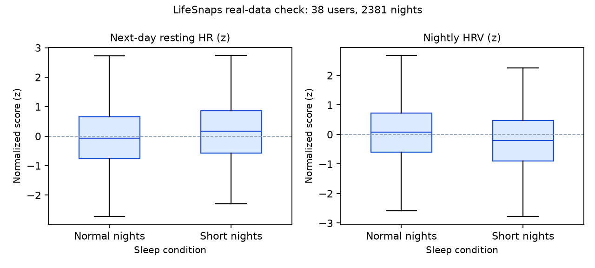

# SleepTwin - Results (auto-generated)

_Generated by code (`src/report.py`) on 2026-10-20. Every number below is computed by the pipeline; slides must quote these values._

> Model-based projection for clinical decision support. Research prototype. All patient data is **simulated**.

## 1. Cohort (simulated) and sanity targets

| Check | Value | Target (plan 6.6) |
|---|---|---|
| Virtual patients x days | 300 x 21 | 300 x 21 |
| EHR calibration source | NHANES 2017-Mar 2020 (downloaded) | NHANES 2017-Mar 2020 |
| Wearable calibration source | LifeSnaps daily Fitbit export (downloaded) | LifeSnaps |
| T2D / prediabetes / HTN / OSA (true) / OSA diagnosed | 37.0% / 29.0% / 52.0% / 26.3% / 5.3% | ~40% / ~25% / ~45% / ~20% |
| CGM range (mg/dL) | 66 - 316 | within 60-350 |
| SI drop, 4 nights x 5 h vs 7.5 h | 25.0% | ~25% |
| Next-day glucose event rate (days 15-21) | 20.3% | 15-30% |
| Morning BP event rate (days 15-21) | 22.2% | - |
| Missing nights / CGM missing | 4.5% / 5.0% | ~5% |

Glucose event rate by group: healthy 2.0%, prediabetes 8.4%, t2d 46.5%

## 2. Next-day model - 3-tier ablation

2100 patient-days (300 patients x prediction days 15-21), GroupKFold(5) by patient_id. Fixed alert threshold 0.5; 7 prediction days = 1 patient-week.

### Main: tomorrow's CGM peak > 180 mg/dL

| Model | AUROC | AUPRC | Sensitivity | Specificity | False alerts / patient-week |
|---|---|---|---|---|---|
| EHR-only (static + genetic) | 0.912 | 0.779 | 0.64 | 0.95 | 0.28 |
| Wearables-only | 0.923 | 0.809 | 0.62 | 0.96 | 0.25 |
| **Fused twin** | 0.931 | 0.822 | 0.64 | 0.96 | 0.23 |

Prevalence: 20.3%. **Interpretation:** Fusing the health record with the wearable stream (AUROC 0.93) beats the record alone (0.91) and the wearables alone (0.92); within diabetics only the gain is larger (0.85 -> 0.88), because the same night means more for a high-risk patient.

T2D-only subgroup (harder, within-diabetic discrimination): AUROC EHR-only 0.853 / wearables-only 0.874 / fused 0.878.

### Secondary: morning SBP > 145 mmHg

| Model | AUROC | AUPRC | Sensitivity | Specificity | False alerts / patient-week |
|---|---|---|---|---|---|
| EHR-only (static + genetic) | 0.897 | 0.757 | 0.57 | 0.96 | 0.21 |
| Wearables-only | 0.641 | 0.362 | 0.21 | 0.93 | 0.37 |
| **Fused twin** | 0.934 | 0.814 | 0.67 | 0.95 | 0.26 |

Prevalence: 22.2%. **Interpretation:** Fusing the health record with the wearable stream (AUROC 0.93) beats the record alone (0.90) and the wearables alone (0.64); within diabetics only the gain is larger (0.86 -> 0.91), because the same night means more for a high-risk patient.

T2D-only subgroup (harder, within-diabetic discrimination): AUROC EHR-only 0.864 / wearables-only 0.587 / fused 0.910.

Top fused-model features (mean |SHAP|): `hba1c` 1.10, `cgm_max_prev_24h` 0.97, `tir_prev_24h` 0.78, `cgm_mean_z` 0.50, `odi_z` 0.22, `bedtime_shift` 0.22, `age` 0.19, `eff_delta` 0.18

### Demo personas (out-of-fold forecasts for day 21)

| Persona | Glucose risk | BP risk | Band | Expected |
|---|---|---|---|---|
| A | 86.7% | 25.8% | Critical | Critical (~80%+) |
| B | 0.8% | 73.5% | Warning | Warning (~65-75%) |
| C | 0.2% | 0.2% | Stable | Stable (<20%) |

Bands use max(glucose, BP) risk: Critical >= 75%, Warning >= 40%.

## 3. 2-hour glucose spike alert

28224 hourly samples (07:00-21:00, CGM < 160 mg/dL) from 300 patients; event rate 4.7% (target 5-20%).

| Metric | Value |
|---|---|
| AUROC | 0.951 |
| AUPRC | 0.611 |
| Plain CGM-trend baseline AUROC (current value + 30-min slope) | 0.785 |
| Alert threshold | 0.4 |
| Sensitivity (samples) | 0.50 |
| Spike episodes warned | 494 / 829 (59.6%) |
| **Median warning lead time** | **70 min** (IQR 40-95) |
| False alerts / patient-week | 1.28 |

**Interpretation:** the twin warns about 59.6% of spikes a median 70 minutes before they happen, beating a plain trend arrow (AUROC 0.95 vs 0.79) because it also knows the meal, last night's sleep and the patient's record.

## 4. Real-data validation (LifeSnaps, real Fitbit volunteers)

- 38 users, 2381 nights (592 short); short night = TST below the user's own 25th percentile.
- Resting HR z-score: short +0.15 vs normal -0.05 (paired median diff +0.18 SD; 68% of users higher; Wilcoxon p = 0.0028).
- HRV z-score: short -0.21 vs normal +0.07 (paired median diff -0.28 SD; 76% of users lower; Wilcoxon p = 2.4e-05).
- **Interpretation:** Across 38 real Fitbit users (2381 nights), short nights were followed by resting HR +0.20 SD and HRV -0.28 SD relative to the same person's normal nights (paired Wilcoxon p = 0.00282 for RHR, 2.43e-05 for HRV). Deviation from a personal baseline - the core idea of the twin - is visible in real data.

## 5. Honest limitations

- Trained and tested on **simulated** patients; the glucose labels come from the same simulator that encodes the sleep -> insulin-sensitivity effect, so the next-day results show the pipeline works, not clinical validity (circularity).
- Pooled AUROC is helped by easy between-patient differences (healthy people almost never spike); the T2D-only subgroup number is the harder test.
- NHANES is a US population; Indian-specific calibration (e.g. ICMR-INDIAB) is future work.
- Genetic markers are simulated from published allele frequencies with small effects.
- Next step: retrospective validation on real, anonymized CGM + wearable data with ethics approval.
